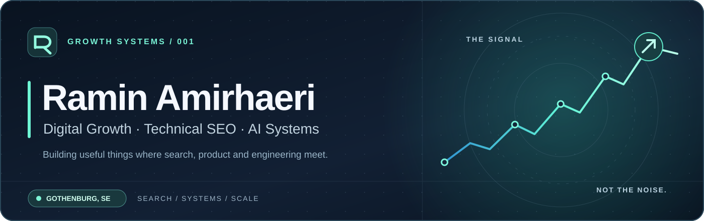
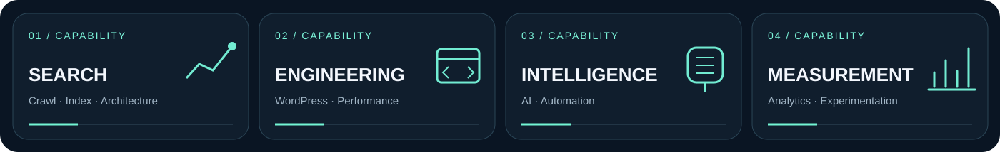

<div align="center">



</div>

### Hey, I'm Ramin 👋

I work where **search, product and engineering** meet. I'm a **Digital Growth Manager** and the founder of **Ramfa SEO**, based in Sweden.

My work is about making digital products easier to discover, faster to use and simpler to improve. Some days that's technical SEO and indexation; other days it's WordPress architecture, performance troubleshooting, or building AI-assisted workflows that actually save time.

**What matters to me:** thoughtful execution, clean foundations and measurable growth. No manufactured metrics or shiny dashboards for their own sake.

### What I work on

<div align="center">



</div>

| Focus | How I work |
|:--|:--|
| **Technical SEO** | Crawlability, indexing, information architecture, canonicalization, hreflang, structured data. |
| **Web & platform engineering** | WordPress, technical performance, integrations, stability, and cross-functional delivery. |
| **AI & automation** | Practical assistants and workflows that reduce repetitive work while keeping people in control. |
| **Digital growth** | Analytics, Search Console, prioritization, experiments, and connecting execution with outcomes. |

### The way I approach a problem

```text
DISCOVER → DIAGNOSE → PRIORITIZE → BUILD → MEASURE → IMPROVE
```

I prefer a clear diagnosis over another checklist, production-ready work over quick fixes, and reporting that explains what changed **and why it matters**.

### Beyond the code — on Instagram

I share practical, short-form notes on **SEO, AI tools and digital growth** — ideas you can actually try, not just buzzwords.

<div align="center">

<a href="https://www.instagram.com/ramin_amirhaeri/" target="_blank" rel="noopener noreferrer">
  
</a>

[**Follow along on Instagram ↗**](https://www.instagram.com/ramin_amirhaeri/)

</div>

### Notes from the field

I write about technical search problems found on real sites, with implementation details rather than recycled advice.

- [Canonical tags: resolving duplicate-content signals](https://insights.ramfaseo.se/canonical-tags-explained-how-to-fix-duplicate-content-without-killing-rankings-real-world-rules-not-theory/)
- [Hreflang: avoiding international SEO chaos](https://insights.ramfaseo.se/hreflang-done-right-avoiding-international-seo-chaos-on-multilingual-sites-without-creating-duplicate-content/)
- [Programmatic SEO: thinking in systems, not just templates](https://insights.ramfaseo.se/programmatic-seo-keyword-research/)

[**More articles and practical notes ↗**](https://insights.ramfaseo.se/)

### A few things worth knowing

- I work across **strategy and implementation** — from the audit to the changes that ship.
- I like the less glamorous, high-leverage work: crawl access, server behavior, performance, and reliable automation.
- Most commercial engineering work stays in **private repositories**. Client code, infrastructure and confidential data don't belong in a public portfolio.
- I care about the details, but what matters most is the experience people actually get.

### Find me elsewhere

[**Ramfa SEO ↗**](https://ramfaseo.ca/) · [**Technical insights ↗**](https://insights.ramfaseo.se/) · [**Instagram ↗**](https://www.instagram.com/ramin_amirhaeri/)

<br />

<div align="center">

</div>
